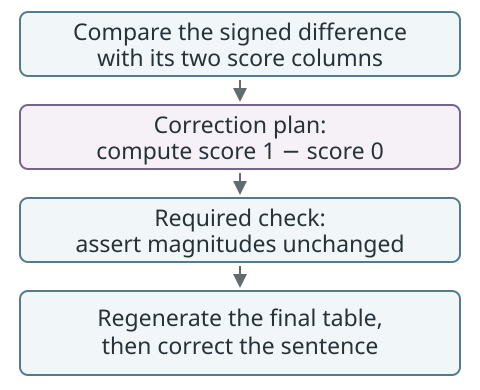

# E03. A sign error made a report sentence false, and the fix went through a one-step plan

Control point: **honesty**

Anonymised from a real project. Source: an approved one-step plan in project A. The gate blocked the job submission because it read the submit command's option values as paths. The agent proposed a narrow plan instead of working around the block. Deny text regenerated on the fixture.



This schematic shows the planned report-stage correction, not a new model fit or
a claim that its checks have already passed. No research values are illustrated.

<details>
<summary>Check your understanding: does this sign error require refitting every model?</summary>

The plan in this episode targets only the report stage. It recomputes the signed
difference from the score columns and requires a check that magnitudes did not
change. That is specific to the diagnosed error, not a rule for every sign error.

</details>

## 1. Socratic: ask these first

- Which number in the report did this plan come from, and what would show it is wrong?
- If every difference is negative, is the model comparison wrong or is the label?
- Which is cheaper and more honest: refit everything, or fix the sign and prove the magnitudes unchanged?

## 2. Situation

A model-comparison table reported "difference = model 1 minus model 0" and every one of N rows was negative. For K of those rows the sign disagreed with the two score columns; the magnitudes all matched to 1e-6. The cause was a lookup that never matched a row name, so the sign was always -1. One report sentence therefore read "model 1 better by more than 2 SE in 0 rows", which was false.

## 3. What the tool showed

```text
mycelium-extra gate: blocked because no active approved plan covers this run.
  - sbatch analysis/example/outputs/slurm_%j.out, analysis/example/run_all.sbatch
Active approved plans (last 24 h): <hash>.
```

The agent's plan: one step (resubmit only the report stage, about minutes, not the hours of cross-validation), Validation: "magnitudes asserted equal; delta recomputed from the score columns; final table has positive deltas where score 1 > score 0; report count > 0".

## 4. Track-changes shape

Observed code change: the comparison script now computes `score(a) - score(b)`, and the report script asserts the magnitudes agree. Potential analytical implication: any sentence or figure that quoted the old sign. Gap: the report line quoting "0 rows" had not yet been regenerated. Unknown: other places the same lookup pattern is used.

## 5. What the human decided

Approve the one-step plan; keep the old tables, regenerate only the final one; correct the report sentence after the new count exists.

## 6. Without the tool

The submission would have gone through under the earlier approval's broad wording. Nothing would have asked for a plan stating the reason for the rerun and the check that the magnitudes had not moved.

Basis: 1 plan; related receipts 379 + 196 across both projects (exit 0 in 250 + 157).
