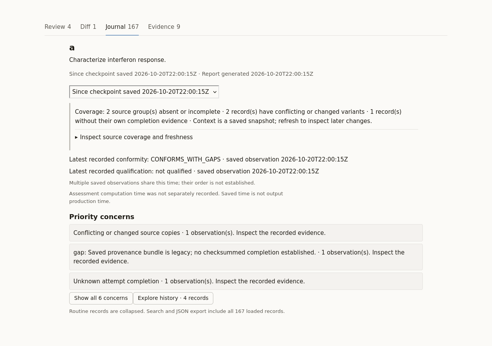
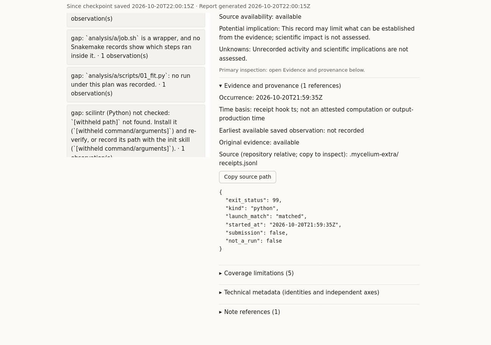

# Track changes: a real report

`track-changes` shows how one analysis moved from what you approved. It reads the gate's and `verify`'s records, writes a short brief and an HTML report, and changes nothing.


In Journal mode, orient yourself before opening one concern and its evidence.
This schematic illustrates navigation; opening a report saves no checkpoint.
The generated screenshots below show the actual synthetic report.

[Open the example report](https://mdmanurung.github.io/mycelium-extra/track-changes-report.html) to see it. It is the real output on a synthetic analysis: invented names, no data. It is a single offline file, so you can also open it from disk.

The report lists what needs your attention first, such as a changed plan choice, a script edited since approval, or work in another analysis while this one was in focus. It then lists what was authorised and what it could not see. You review the diffs, then type `freeze <hash>` or ask `grill` to amend the plan.

New to this? See the [`track-changes` reference](https://github.com/mdmanurung/mycelium-extra/blob/main/docs/reference/skills/track-changes.md) for the options and what it compares.

To regenerate the file, run `python3 tests/e2e/make_track_changes_example.py`.


## Analysis Journal example

Open [the multi-session Journal](analysis-journal.html) or
[its missing-source view](analysis-journal-missing.html). Both are generated,
self-contained offline reports. The synthetic portable records live under
`docs/examples/journal-demo/`; no real research data or scheduler was used.

The overview shows three concerns at most; all six concerns and 167 loaded
records remain discoverable. Search covers collapsed and paged records across
periods. Open a concern, then `Evidence and provenance`, to inspect one record;
`Back to overview` preserves navigation context. Coverage remains visible even
when the selected period has no new events.





Regenerate the fixture with:

```bash
python3.12 tests/e2e/make_journal_example.py
```
To inspect the portable records, copy them outside a gated ancestor so the demo
does not inherit that repository's gate configuration:

```bash
journal_demo=$(mktemp -d /tmp/mycelium-journal-demo.XXXXXX)
cp -R docs/examples/journal-demo/. "$journal_demo/"
python3.12 -B skills/track-changes/scripts/track_changes.py \
  --plugin-root "$PWD" --repo "$journal_demo" --analysis analysis/a \
  --journal --no-write --json
```

Real browser checks use:

```bash
node skills/track-changes/tests/journal_browser.mjs REPORT.html SCREENSHOT_PREFIX
```

Add `--zoom200` for a disposable Firefox profile at actual 200% browser zoom.
This browser test is separate from CI's Node DOM
smoke check. No installed browser/plugin settings are changed.
