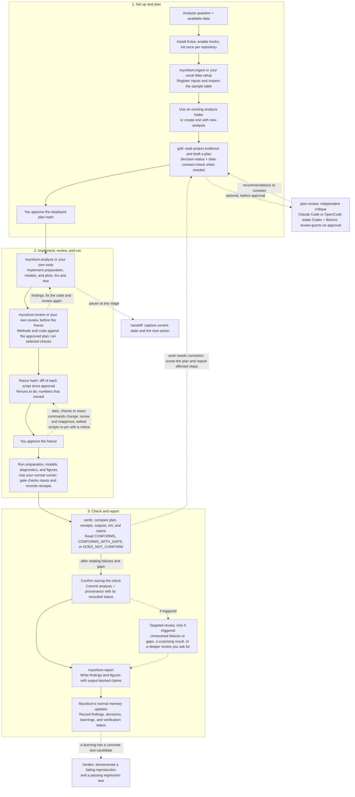

# Full analysis workflow

A reportable analysis from question to report, with Mycelium Extra and Mycelium. In an ordinary repository, use your own implementation, review and reporting tools in place of the `mycelium:*` commands. This is the long path; [usage tiers](../usage.md) show shorter ones.

**Solid arrows show the main path; dotted arrows show optional steps or revisions.**

The first approval covers implementation and test runs; the second freezes
finished code for the reportable run. Once a script has run under an approval,
an edit to it needs that plan approved again (see [Pinned scripts](../approval-gate.md#pinned-scripts)),
so use `allow explore` for a debugging loop. Dry runs still need approval. Use one
`PLAN.md`, revised in place, and record revisions in `TRACKER.md`.

Verification reports missing evidence separately from failures; saving provenance
does not turn a gap or failure into a pass. It checks the execution record, while
code review assesses methods and interpretation, which is why the principal review
comes before the freeze and verification does not replace it. If the final report introduces
new or changed claims, run `verify` again with that document included before
sharing it. See [Verification reference](../verification.md#what-the-report-shows).

## Two checkpoints

Both are your approval of a displayed plan hash. They approve different things,
and the gate checks only part of each.

| | Scientific intent approval | Final execution freeze |
|---|---|---|
| You approve | The question, the choices and their sources, the steps, and the inputs | The finished code and data exactly as they will run |
| When | After `grill`, before implementation | After implementation, lint, review, and checks, before the reportable run |
| Checked mechanically today | The approved hash is tied to the plan text; covered commands are denied until it is approved; `Inputs:` files and the existing scripts the plan table names are pinned when the hash is shown, other covered scripts at their first run; receipts are recorded | `freeze <hash>` pins the scripts as you reviewed them; data under `Inputs:` is pinned when the hash is shown and a launch after it changes is blocked until the revised plan is approved; receipts are recorded |
| Instructional only | That each choice is sourced and the plan complete (`grill`); that independent critique happened (`plan-review`) | That the code is finished and lint-clean, that the principal review and selected checks ran and their findings were fixed, and that the dry run and tool versions are in the plan (`grill`'s run-plan instructions) |

The gate does not check that a review happened or that a test passed, and no test
or review result is tied to an approval. After the run, `verify` compares the
execution record with the plan; it does not re-run tests or review the methods.
See [Approval gate](../approval-gate.md#pinned-scripts) and the
[run-plan reference](https://github.com/mdmanurung/mycelium-extra/blob/main/skills/grill/references/run-plans.md).

Debugging inside an approved scope needs no second interview. After the first
checkpoint, `allow explore <plan hash>` lets the agent fix and re-run code on the
plan's own analysis paths with the exploration prefix, as often as needed, without
a new approval; a run outside those paths is denied and you decide. Changing a
pinned test or expectation, or running a frozen step with other arguments, is
reported to you, and the reportable run then needs the second checkpoint again.
Plain `allow explore` stays the broader, session-wide grant. See
[Exploratory runs](../approval-gate.md#exploratory-runs).

Use `handoff` at any pause. `harden` is for a specific recurring mistake,
not a mandatory finishing step. See [Skill reference](../skills.md) for each tool's
writes and [Mycelium integration](https://github.com/mdmanurung/mycelium-extra/blob/main/docs/mycelium-integration.md) for ownership.
