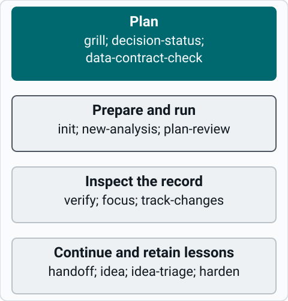

# Skill reference

New here? Start with [Usage tiers](usage.md) to choose a workflow. This page indexes the skills. Each one but `plot-first` (guidance only) has a reference page with its synopsis, subcommands, what it writes, its defaults and how to switch it off. You don't need to learn them all.

Commands use Claude Code syntax. In Codex, use `$mycelium-extra:` instead of `/mycelium-extra:`. OpenCode takes the same `/mycelium-extra:` commands. See [Host compatibility](installation.md#host-compatibility).

This is a task map, not a list of commands to execute in sequence. Read the skill entry for its prerequisites, confirmations and write behavior.

## Common prompts

| Need | Command |
|---|---|
| Make a plan | `/mycelium-extra:grill <your question>` |
| Set up a new repository | `/mycelium-extra:repo-setup` |
| Enable execution checks | `/mycelium-extra:init` |
| Check a completed run | `/mycelium-extra:verify <hash>` |
| Create an analysis folder | `/mycelium-extra:new-analysis analysis/<name>: <question>` |
| List which conclusions in an analysis cite an inspected plot | `/mycelium-extra:plot-first <analysis folder>` |
| Resume in a fresh session | `/mycelium-extra:handoff` |
| Say which analysis this session works on | type `focus <folder>` |
| Remind me where an analysis stands and what to do next | type `where` (or `/mycelium-extra:where`) |
| See what changed against the approved plan | `/mycelium-extra:track-changes` |
| Park a passing idea | `/mycelium-extra:idea <idea>` |
| Choose the next idea | `/mycelium-extra:idea-triage` |

To learn how the gate works, read [the approval gate](approval-gate.md) and the [verification reference](verification.md).

## grill

Turns your question into a sourced, numbered plan. It is read-only. For scientific work, after asking your question and retrieving project evidence, it discovers activated Mycelium convention packs and reads the relevant guides selectively. Marketplace presence alone does not activate a pack. Applicable rules, exceptions, sources and falsifiable checks enter the plan; they provide neither scientific proof nor execution approval, and the five-question cap remains unchanged. See [grill](https://github.com/mdmanurung/mycelium-extra/blob/main/docs/reference/skills/grill.md).

## init

Turns on the approval gate for a repository. See [init](https://github.com/mdmanurung/mycelium-extra/blob/main/docs/reference/skills/init.md).

## repo-setup

Sets up a new analysis repository (Mycelium init and the gate) or Python package (`ericmjl/cookiecutter-python-project`), then lucid-coder's style and environment pointer. See [repo-setup](https://github.com/mdmanurung/mycelium-extra/blob/main/docs/reference/skills/repo-setup.md).

## verify

Checks what ran against the approved plan and saves provenance once you confirm. See [verify](https://github.com/mdmanurung/mycelium-extra/blob/main/docs/reference/skills/verify.md).

## new-analysis

Scaffolds a new analysis folder in the [analysis layout](concepts/analysis-layout.md): steps `01_prepare.R`, `02_fit.R`, `03_show.R`, a `theme.R`/`theme.py` on `ggpubr::theme_pubr`, `plans/`, a Snakefile that writes each step to `outputs/<script stem>/` (a rerun overwrites it), and `run.sh`, which runs the steps and logs what changed in `logs/CHANGES.md`. With `--panels`, it adds a manuscript layer (a plot stub per panel, a figure map and a `manuscript-audit` contract), also to an existing folder without overwriting anything. See [new-analysis](https://github.com/mdmanurung/mycelium-extra/blob/main/docs/reference/skills/new-analysis.md).

## analysis-report

Fills the Quarto report `new-analysis` scaffolds in `reports/`: Overview with a mermaid chain of the steps, Methods and Results tabs, quoted script excerpts and inspected figures from the step folders (`outputs/*/figures/`; an older analysis uses `outputs/current`); figures are paired with their source data by stem, and a missing table is a gap. After a render it adds the report's row to the analysis doc's Outputs table. `analysis-report artifact <folder>` builds a one-off evaluation page from the filled report, checks every number on it against the report, and publishes only after you agree (Claude Code only). Rendering is a gated run. See [analysis-report](https://github.com/mdmanurung/mycelium-extra/blob/main/docs/reference/skills/analysis-report.md).

## plot-first

Makes saved plots the primary artifacts for interpreting analysis results. Each conclusion links an inspected figure and panel. An interpretive table needs a stated reason a plot is inadequate. `grill` loads this guidance for analysis plans; `new-analysis` carries it into the analysis doc and plan. Existing numeric provenance and workflow status tables stay in place. This is agent guidance, not a gate-enforced check. See the [skill instructions](https://github.com/mdmanurung/mycelium-extra/blob/main/skills/plot-first/SKILL.md).

## plan-review

Challenges a plan before you approve it. Nothing leaves the machine without your consent. See [plan-review](https://github.com/mdmanurung/mycelium-extra/blob/main/docs/reference/skills/plan-review.md).

## decision-status

Finds which past Mycelium decision applies. See [decision-status](https://github.com/mdmanurung/mycelium-extra/blob/main/docs/reference/skills/decision-status.md).

## data-contract-check

Compares a plan's assumptions with your sample tables or H5AD `obs`. See [data-contract-check](https://github.com/mdmanurung/mycelium-extra/blob/main/docs/reference/skills/data-contract-check.md).

## manuscript-audit

Read-only audit of a manuscript repository's figure/table lineage, source data and reporting, with an optional small deterministic contract check: run ad hoc on stdin before approval, or as a project copy bound in a plan's `test_paths` so `verify` can attribute its result. See [manuscript-audit](https://github.com/mdmanurung/mycelium-extra/blob/main/docs/reference/skills/manuscript-audit.md).

## focus

Say which analysis this session works on. See [focus](https://github.com/mdmanurung/mycelium-extra/blob/main/docs/reference/skills/focus.md).

## where

A short card for one analysis: aim, where it stands, what to do next. See [where](https://github.com/mdmanurung/mycelium-extra/blob/main/docs/reference/skills/where.md).

## track-changes

Shows what changed against the approved plan. It is read-only. See [track-changes](https://github.com/mdmanurung/mycelium-extra/blob/main/docs/reference/skills/track-changes.md).

## handoff

Writes a short `HANDOFF.md` for a fresh session: the goal, the next action, the newest `logs/CHANGES.md` entry (or, for a legacy run, its `RUN.txt` status), what was assumed but not run, and each open item with a lean marked as not a decision. `handoff test` has a fresh reader try the file, or a filled report, from a staged copy of it and the files it points to, and lists what it could not follow. It is an instruction to the reader, not a sandbox. See [handoff](https://github.com/mdmanurung/mycelium-extra/blob/main/docs/reference/skills/handoff.md).

## questionnaire

Writes the questions only a PI, core facility or collaborator can answer into a Markdown file to send them. See [questionnaire](https://github.com/mdmanurung/mycelium-extra/blob/main/docs/reference/skills/questionnaire.md).

## idea

Parks a passing idea without a question. See [idea](https://github.com/mdmanurung/mycelium-extra/blob/main/docs/reference/skills/idea.md).

## idea-triage

Ranks the open ideas so you can pick the next one. See [idea-triage](https://github.com/mdmanurung/mycelium-extra/blob/main/docs/reference/skills/idea-triage.md).

## harden

Turns a learning's mitigation into a test. See [harden](https://github.com/mdmanurung/mycelium-extra/blob/main/docs/reference/skills/harden.md).
